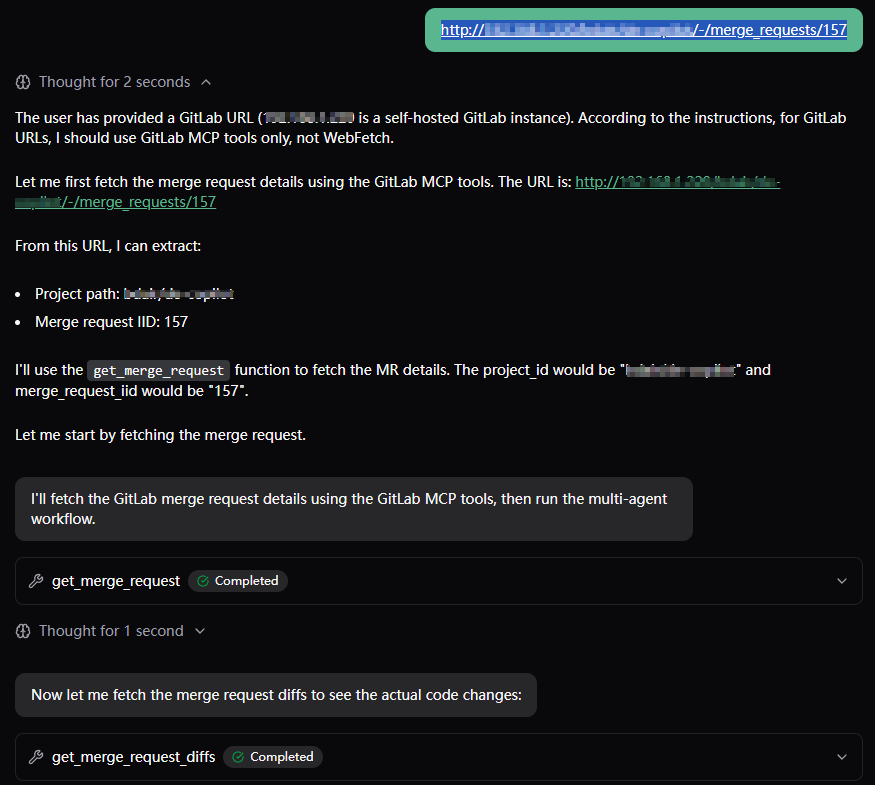
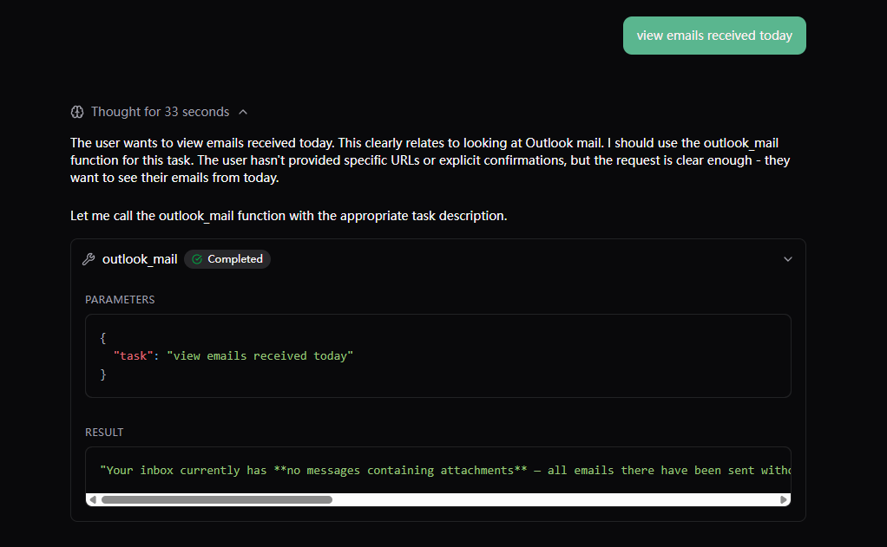

# agent-playbook

[中文](README_CN.md) | [English](README.md)

agent-playbook turns YAML agent specs into a pydantic-ai [`Capability`](https://ai.pydantic.dev/capabilities/)-based agent: named skill nodes, DynamicWorkflow orchestration, optional MCP tools, and an isolated OpenSandbox for untrusted code.

## Features

- Spec-driven agents from YAML (`Agent.from_file` with capabilities). With two or more specs loaded, the web chat enters through a routing agent
- [`Playbook`](src/harness/playbook): named skill nodes, DynamicWorkflow orchestration, optional MCP
- [`OpenSandbox`](src/harness/open_sandbox): isolated container workspace for untrusted code
- Built-in `code-review`, using `@zereight/mcp-gitlab` MCP
- Built-in `outlook-mail`, using `@softeria/ms-365-mcp-server` MCP

## Installation

Python 3.10+. Uses [uv](https://docs.astral.sh/uv/) for dependencies (includes `pydantic-ai-harness[dynamic-workflow]`, `pydantic-ai-skills`, and `opensandbox`):

```bash
git clone --recurse-submodules https://github.com/lhp0630/agent-playbook.git && cd agent-playbook
uv sync --all-groups --extra agent
```

`--extra agent` installs the server extras (`fire`, `uvicorn`, …). The reusable lib is the `harness` package under `src/harness/`; the CLI/web app is `agent` under `src/agent/`.

If you already cloned without submodules:

```bash
git submodule update --init --recursive
```

Skill packages live under `.agents/skills/` (`code-review-skill`).

## Quick Start

Copy `.env.example` to `.env` and set credentials:

```bash
# Model fallback when playbook `models` is omitted
OPENAI_MODEL=...
OPENAI_BASE_URL=...
OPENAI_API_KEY=...

# Optional — enable GitLab MCP for GitLab URLs
GITLAB_API_URL=https://gitlab.example.com/api/v4
GITLAB_PERSONAL_ACCESS_TOKEN=glpat-xxx

# Optional — Outlook MCP for outlook-mail (absolute paths; one-time `npx -y @softeria/ms-365-mcp-server --login`)
MS365_MCP_TOKEN_CACHE_PATH=/absolute/path/.config/ms365-mcp/.token-cache.json
MS365_MCP_SELECTED_ACCOUNT_PATH=/absolute/path/.config/ms365-mcp/.selected-account.json

# Optional — OpenSandbox server for harness.open_sandbox.OpenSandbox
OPEN_SANDBOX_API_KEY=...
OPEN_SANDBOX_DOMAIN=localhost:8080
```

Run a playbook:

```bash
agent
```

Open `http://127.0.0.1:8000`. With both built-in specs loaded, ask for a code review or for help with Outlook mail.

## Web chat

With more than one agent spec loaded, the web chat's only entry is the routing agent. It decides whether to hand the turn off to one agent or ask a clarifying question. The routing capability holds each agent's complete message history for that conversation. When the conversation switches between agents, each history stays in place: the history handed to outlook-mail does not include code-review's tool records. The routing agent's own chat transcript is still stored by `to_web`, and the router uses it to decide whether the new message continues the previous agent.

With a single spec loaded, the web chat talks to that agent directly.

## Programmatic usage

Import capabilities from `harness` (the `agent` package is the server entrypoint only):

```python
from pydantic_ai import Agent

from harness.playbook import Playbook

agent = Agent.from_file(
    '.agents/code-review.yaml',
    custom_capability_types=[Playbook],
)
```

Or construct the capability in code:

```python
from pydantic_ai import Agent
from harness.playbook import Playbook

agent = Agent(
    'openai:ornith:35b',
    capabilities=[
        Playbook(
            name='code-review',
            nodes=[],
            mcp_servers=[],
            models={'name': 'openai-chat:ornith:35b', 'model_provider': 'openai'},
            model_providers=[
                {
                    'name': 'openai',
                    'base_url': 'https://api.openai.com/v1',
                    'api_key': '...',
                }
            ],
        )
    ],
)
```

See [`src/harness/playbook/README.md`](src/harness/playbook/README.md) for Playbook details.

### OpenSandbox

```python
from pydantic_ai import Agent
from pydantic_ai_harness.filesystem import FileSystem
from pydantic_ai_harness.shell import Shell
from harness.open_sandbox import OpenSandbox

agent = Agent(
    'openai:ornith:35b',
    capabilities=[OpenSandbox(), Shell(), FileSystem()],
)
```

See [`src/harness/open_sandbox/README.md`](src/harness/open_sandbox/README.md) for the workspace, lifetime, and agent-spec YAML.

## Example

| Code Review | Outlook Mail |
| --- | --- |
|  |  |
