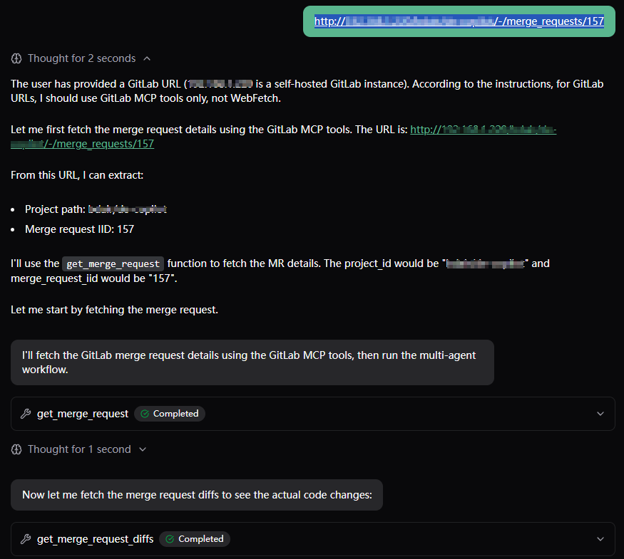
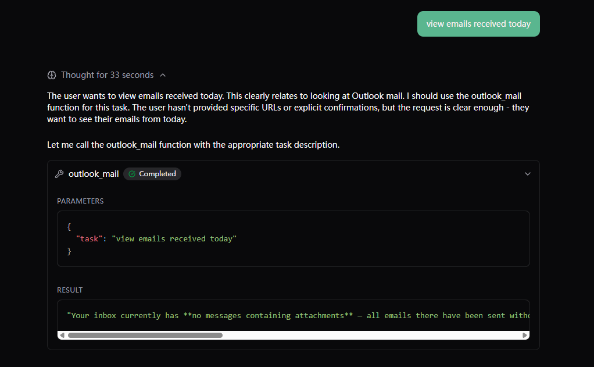

# agent-playbook

[中文](README_CN.md) | [English](README.md)

Agents driven by YAML Agent Specs.

## Features

- With multiple Playbook Specs loaded, entry goes through a supervisor agent
- Top-level MCP servers and multi-provider models on each Playbook Spec
- Skills and other capabilities via the standard agent `capabilities` list

## Installation

Python 3.11+. Uses [uv](https://docs.astral.sh/uv/) for dependencies (includes `pydantic-ai-skills`):

```bash
git clone --recurse-submodules https://github.com/lhp0630/agent-playbook.git && cd agent-playbook
uv sync --all-groups --extra agent
```

`--extra agent` installs the server extras (`fire`, `uvicorn`, `pyyaml`, …). The reusable lib is the `harness` package under `src/harness/`; the CLI/web app is `agent` under `src/agent/`.

If you already cloned without submodules:

```bash
git submodule update --init --recursive
```

Skill packages live under `.agents/skills/` (`code-review-skill`).

## Quick Start

Copy `.env.example` to `.env` and set credentials:

```bash
# Optional — provider env vars for name-only Model entries (anthropic:/google:/openai-chat: via infer_model)
# OPENAI_API_KEY=...
# ANTHROPIC_API_KEY=...

# Optional — enable GitLab MCP for GitLab URLs
GITLAB_API_URL=https://gitlab.example.com/api/v4
GITLAB_PERSONAL_ACCESS_TOKEN=glpat-xxx

# Optional — Outlook MCP for outlook-mail (absolute paths; one-time `npx -y @softeria/ms-365-mcp-server --login`)
MS365_MCP_TOKEN_CACHE_PATH=/absolute/path/.config/ms365-mcp/.token-cache.json
MS365_MCP_SELECTED_ACCOUNT_PATH=/absolute/path/.config/ms365-mcp/.selected-account.json
```

Run a playbook:

```bash
agent
```

Open `http://127.0.0.1:8000`. With both built-in specs loaded, ask for a code review or for help with Outlook mail.

## Web chat

With more than one agent spec loaded, the web chat's only entry is the supervisor agent. It decides whether to hand the turn off to one agent or ask a clarifying question. The supervisor capability holds each agent's complete message history for that conversation. When the conversation switches between agents, each history stays in place: the history handed to outlook-mail does not include code-review's tool records. The supervisor agent's own chat transcript is still stored by `to_web`, and the supervisor uses it to decide whether the new message continues the previous agent.

With a single spec loaded, the web chat talks to that agent directly.

## Programmatic usage

```python
from agent import PlaybookSpec
from agent.supervisor import CUSTOM_CAPABILITY_TYPES

spec = PlaybookSpec.from_file('.agents/code-review.yaml')
agent = spec.to_agent(custom_capability_types=CUSTOM_CAPABILITY_TYPES)
```

- [`PlaybookSpec`](src/agent/playbook_spec.py) — AgentSpec plus `mcp_servers` / `models` / `model_providers`
- [`Model`](src/harness/models/README.md) — optional Model capability and multi-provider helpers
- [`harness.mcp`](src/harness/mcp/README.md) — Claude-compatible MCP toolset builders

## Example

| Code Review | Outlook Mail |
| --- | --- |
|  |  |
