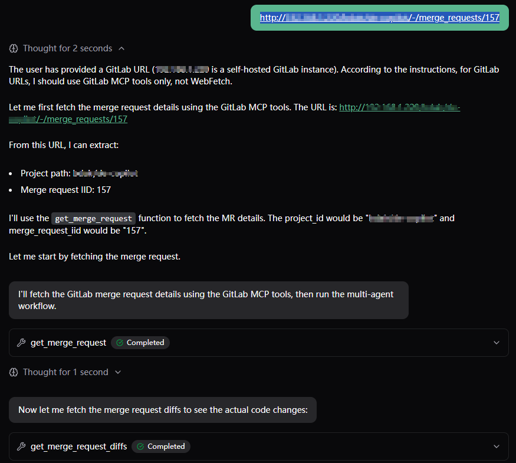
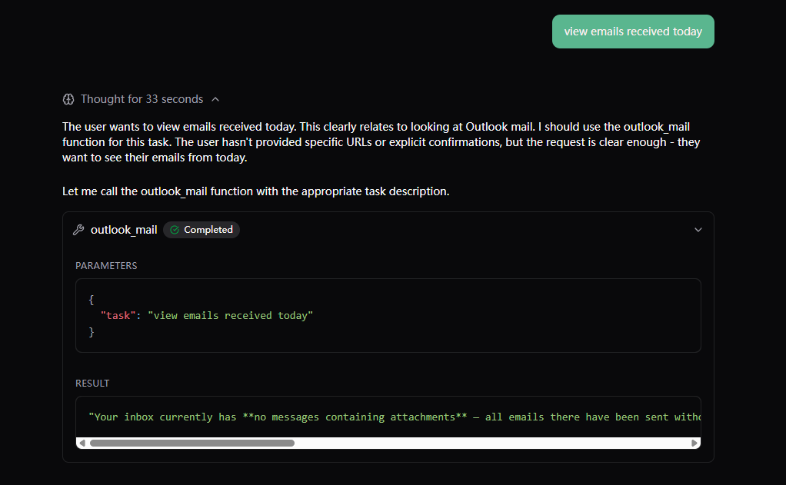

# agent-playbook

[中文](README_CN.md) | [English](README.md)

由 YAML 格式 Agent Spec 驱动的智能体。

## 功能

- 加载多个 Playbook Spec 时，经 supervisor 智能体进入
- 每个 Playbook Spec 顶层配置 MCP 与多 provider 模型菜单
- Skills 等能力走标准 `capabilities` 列表

## 安装

Python 3.11+，依赖管理使用 [uv](https://docs.astral.sh/uv/)（已包含 `pydantic-ai-skills`）：

```bash
git clone --recurse-submodules https://github.com/lhp0630/agent-playbook.git && cd agent-playbook
uv sync --all-groups --extra agent
```

`--extra agent` 会安装服务端依赖（`fire`、`uvicorn`、`pyyaml` 等）。可复用库在 `src/harness/` 的 `harness` 包；CLI/Web 应用在 `src/agent/` 的 `agent` 包。

若已克隆但未拉取子模块：

```bash
git submodule update --init --recursive
```

技能包位于 `.agents/skills/`（`code-review-skill`）。

## 快速开始

复制 `.env.example` 为 `.env`，填入凭证：

```bash
# 可选 — 仅 name 的 Model 条目走 infer_model 时需要的厂商环境变量（anthropic:/google:/openai-chat:）
# OPENAI_API_KEY=...
# ANTHROPIC_API_KEY=...

# 可选 — 启用 GitLab MCP，用于 GitLab 地址
GITLAB_API_URL=https://gitlab.example.com/api/v4
GITLAB_PERSONAL_ACCESS_TOKEN=glpat-xxx

# 可选 — outlook-mail 的 Outlook MCP（绝对路径；一次性执行 `npx -y @softeria/ms-365-mcp-server --login`）
MS365_MCP_TOKEN_CACHE_PATH=/absolute/path/.config/ms365-mcp/.token-cache.json
MS365_MCP_SELECTED_ACCOUNT_PATH=/absolute/path/.config/ms365-mcp/.selected-account.json
```

运行 Playbook：

```bash
agent
```

访问 `http://127.0.0.1:8000`。两个内置 Spec 都加载时，可以要求代码评审，或处理 Outlook 邮件。

## 网页对话

加载了多个 Agent Spec 时，网页对话的唯一入口是 supervisor Agent。它决定把这一轮转交给某一个 Agent，或向用户追问。supervisor capability 按会话保存每个 Agent 的完整 message history。同一会话里来回切换 Agent 时，各自的历史都还在：交给 outlook-mail 的历史不会带上 code-review 的工具记录。supervisor Agent 自己的聊天记录仍由 `to_web` 保存，用来判断这一轮是不是在延续上一个 Agent。

只加载了一个 Spec 时，网页对话直接进入该 Agent。

## 编程接入

```python
from agent import PlaybookSpec
from agent.supervisor import CUSTOM_CAPABILITY_TYPES

spec = PlaybookSpec.from_file('.agents/code-review.yaml')
agent = spec.to_agent(custom_capability_types=CUSTOM_CAPABILITY_TYPES)
```

- [`PlaybookSpec`](src/agent/playbook_spec.py) — AgentSpec + `mcp_servers` / `models` / `model_providers`
- [`Model`](src/harness/models/README.md) — 可选 Model capability 与多 provider 解析
- [`harness.mcp`](src/harness/mcp/README.md) — 对齐 Claude 的 MCP toolset 构建

## 示例

| Code Review | Outlook Mail |
| --- | --- |
|  |  |
