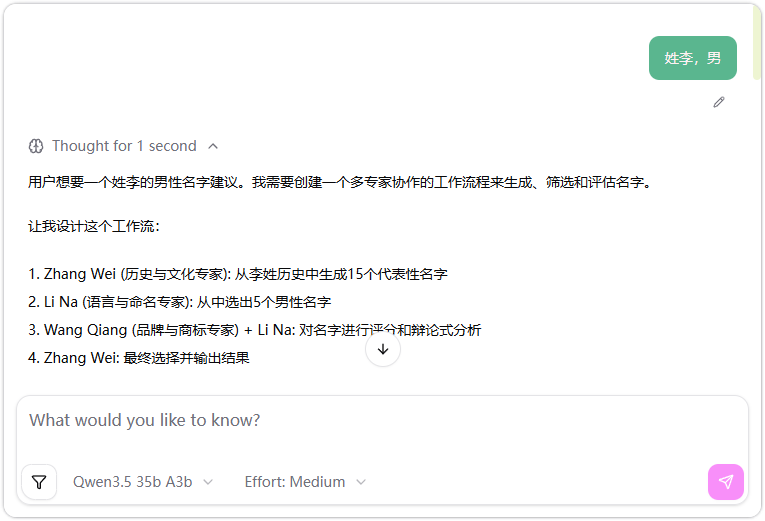
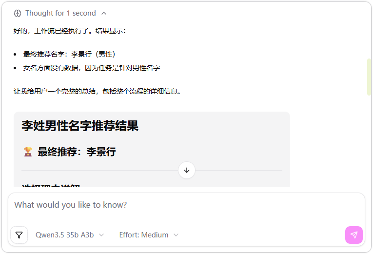
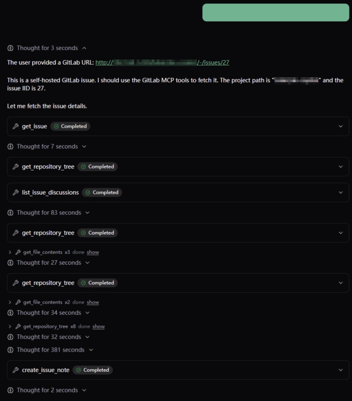

# agent-playbook

[中文](README_CN.md) | [English](README.md)

agent-playbook 将 YAML Agent Spec 封装为基于 pydantic-ai [`Capability`](https://ai.pydantic.dev/capabilities/) 的智能体：命名 Skill 节点、DynamicWorkflow 编排、可选 MCP 工具，以及用于执行不可信代码的隔离 OpenSandbox。

## 功能

- **`Playbook` Capability**（[`harness.playbook`](src/harness/playbook/)）：通过 `Agent(..., capabilities=[Playbook(...)])` 挂载，或在 Agent Spec YAML 中声明
- **`OpenSandbox` Capability**（[`harness.open_sandbox`](src/harness/open_sandbox/)）：在隔离容器中提供 shell / 文件工具（功能对齐 `pydantic_ai_harness.modal_sandbox`）
- 在 [`.agents/`](.agents/) 用声明式 Agent Spec，经 `Agent.from_file(..., custom_capability_types=[Playbook, OpenSandbox])` 加载
- 内置 `code-review`（第一性原理 → 5 Whys → 代码审查），支持 GitHub WebFetch 与 GitLab MCP

## 安装

Python 3.10+，依赖管理使用 [uv](https://docs.astral.sh/uv/)（已包含 `pydantic-ai-harness[dynamic-workflow]` 与 `pydantic-ai-skills[opensandbox]`）：

```bash
git clone --recurse-submodules https://github.com/lhp0630/agent-playbook.git && cd agent-playbook
uv sync --all-groups --extra agent
```

`--extra agent` 会安装服务端依赖（`fire`、`uvicorn` 等）。可复用库在 `src/harness/` 的 `harness` 包；CLI/Web 应用在 `src/agent/` 的 `agent` 包。

若已克隆但未拉取子模块：

```bash
git submodule update --init --recursive
```

技能包位于 `.agents/skills/`（`first-principles-skill`、`5-whys-skill`、`code-review-skill`）。

## 快速开始

复制 `.env.example` 为 `.env`，填入凭证：

```bash
# 省略 playbook `models` 时的模型回退
OPENAI_MODEL=...
OPENAI_BASE_URL=...
OPENAI_API_KEY=...

# 可选 — 启用 GitLab MCP，用于 GitLab 地址
GITLAB_API_URL=https://gitlab.example.com/api/v4
GITLAB_PERSONAL_ACCESS_TOKEN=glpat-xxx

# 可选 — OpenSandbox 服务，用于 harness.open_sandbox.OpenSandbox
OPEN_SANDBOX_API_KEY=...
OPEN_SANDBOX_DOMAIN=localhost:8080
```

运行 Playbook：

```bash
agent
```

访问 `http://127.0.0.1:8000`，粘贴 GitHub PR URL，或 GitLab MR / Issue URL。

## 编程接入

从 `harness` 导入 Capability（`agent` 包仅作为服务入口）：

```python
from pydantic_ai import Agent

from harness.playbook import Playbook

agent = Agent.from_file(
    '.agents/code-review.yaml',
    custom_capability_types=[Playbook],
)
```

也可在代码中直接构造 Capability：

```python
from pydantic_ai import Agent
from harness.playbook import Playbook

agent = Agent(
    'openai:ornith:35b',
    capabilities=[
        Playbook(
            name='code-review',
            nodes=[],
            mcp_servers=[],
            models={'name': 'openai-chat:ornith:35b', 'model_provider': 'openai'},
            model_providers=[
                {
                    'name': 'openai',
                    'base_url': 'https://api.openai.com/v1',
                    'api_key': '...',
                }
            ],
        )
    ],
)
```

更多说明见 [`src/harness/playbook/README.md`](src/harness/playbook/README.md)。

### OpenSandbox

```python
from pydantic_ai import Agent
from harness.open_sandbox import OpenSandbox

agent = Agent(
    'openai:ornith:35b',
    capabilities=[OpenSandbox()],
)
```

工具、生命周期模式与 Agent Spec YAML 见 [`src/harness/open_sandbox/README.md`](src/harness/open_sandbox/README.md)。

## 示例

| GitHub | GitLab | 结果 | Issues |
| --- | --- | --- | --- |
|  |  |  |  |
